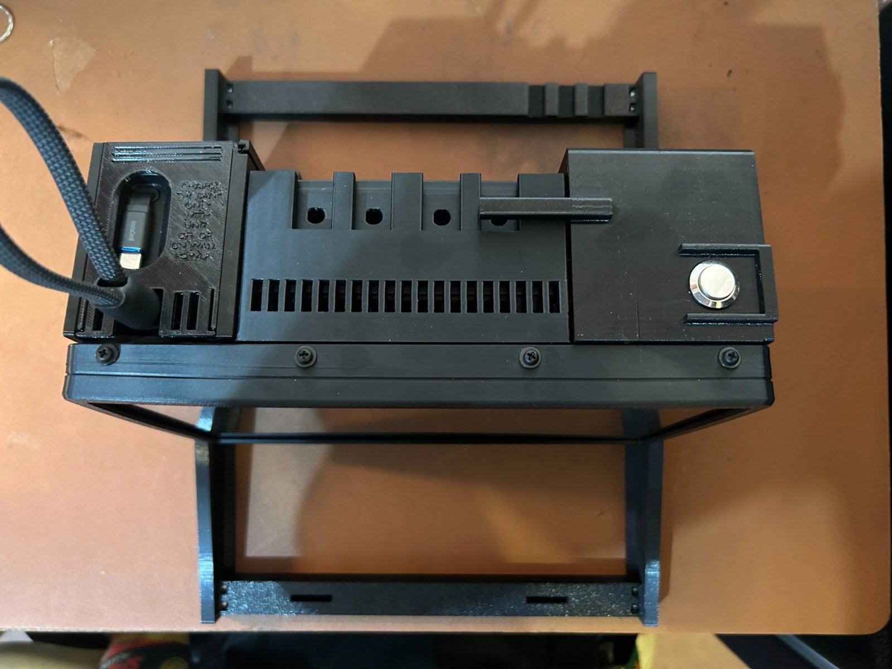
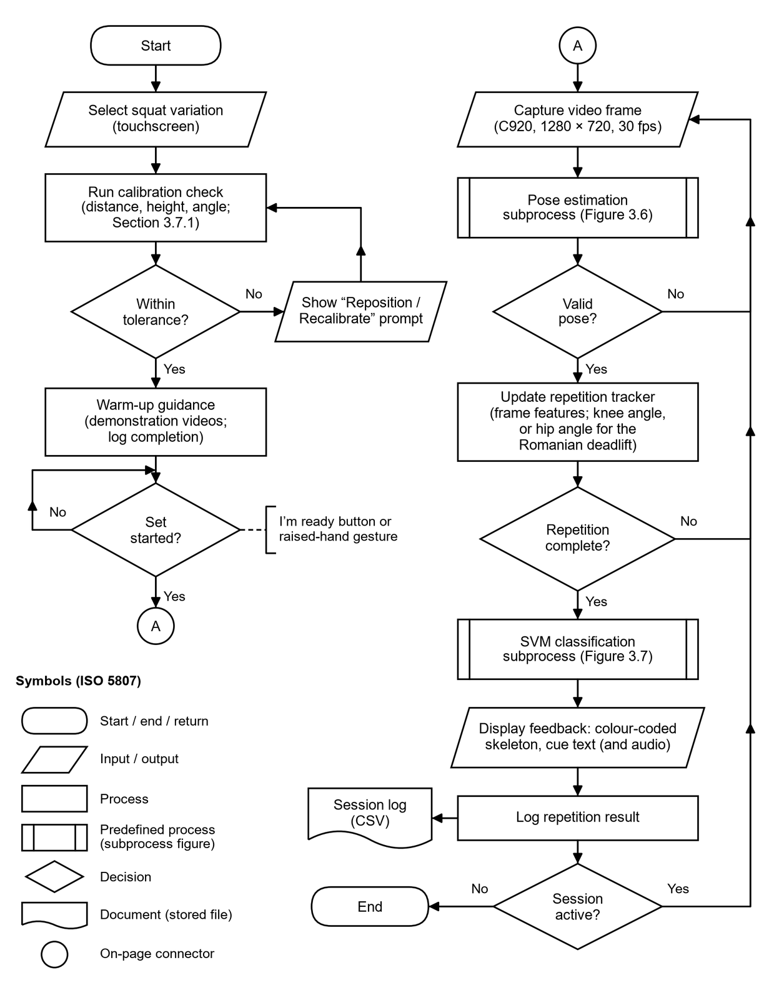
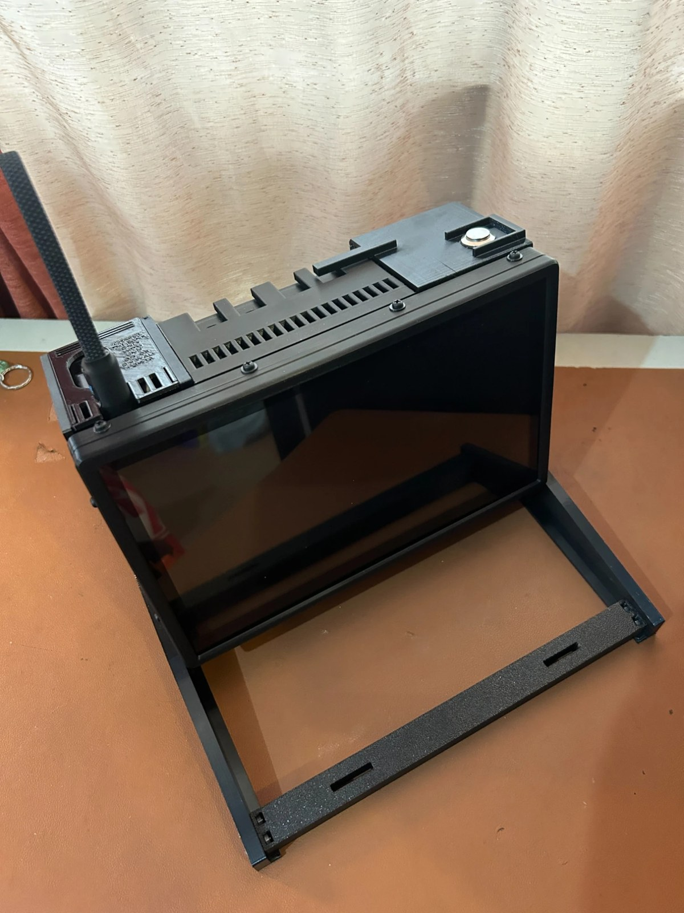
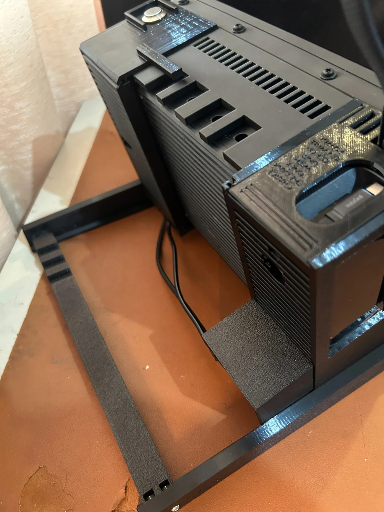
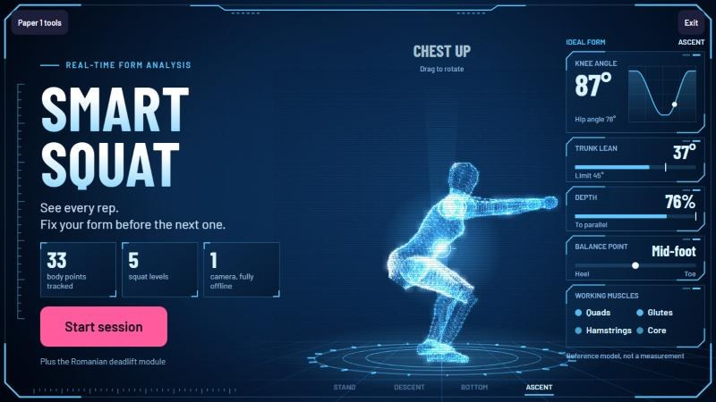
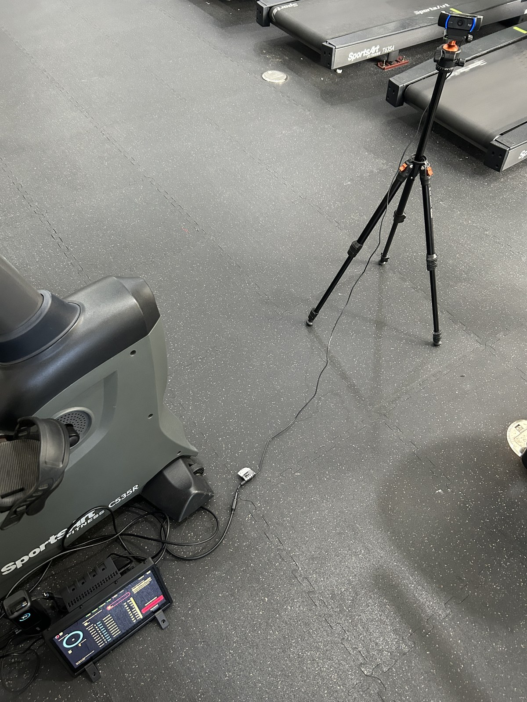
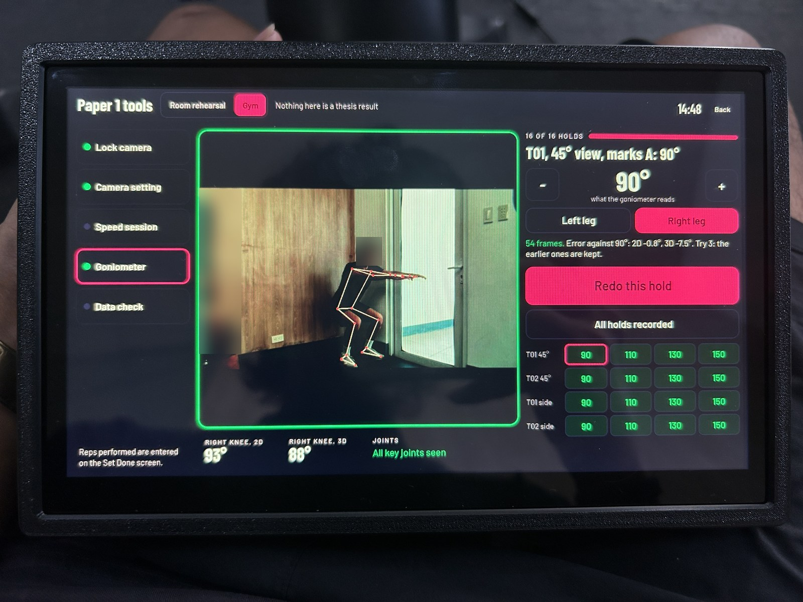
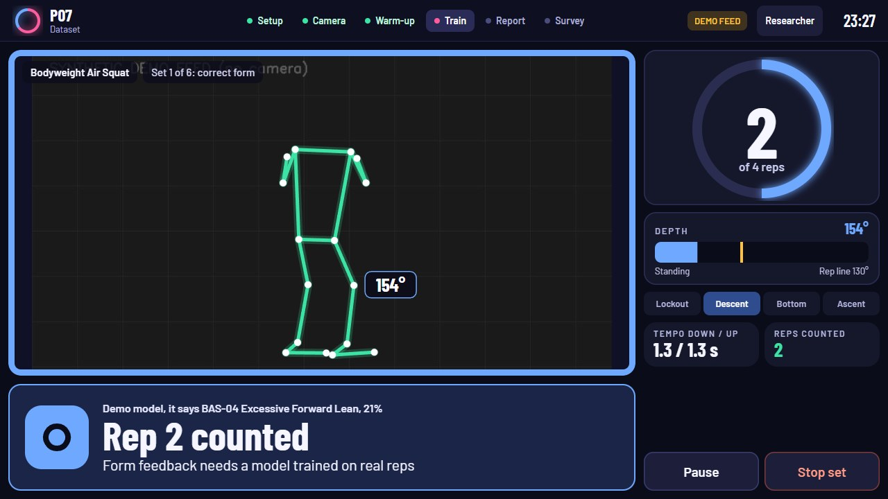

# SmartSquat: pose-based squat form-error detection on a Jetson Orin Nano



*The unit on its printed stand frame, seen from above (13 November 2026): the Jetson case with the printed pods and the push button fitted. The screen is off in this photo.*

**One line:** a standalone unit that watches a lifter with one webcam, finds the body with MediaPipe Pose, turns each repetition into 102 features and classifies it with a support vector machine, then shows the result on a touchscreen, all offline on a Jetson Orin Nano.

**Thesis 2, Mapúa University, ECE.** *Human Pose Estimation-Based Smart Fitness System for Real-Time Form Error Detection in Weighted Squats Using Support Vector Machines.* Two-person team: Chester John B. Cirio and Emmanuel Amir B. Cruz. Adviser: Dr. Charmaine C. Paglinawan.

## Status: prototype in progress

- **Built and running:** the hardware unit, the pose-to-features pipeline, the repetition counter and the touchscreen app. It ran a pilot at a gym on 8 November 2026, on the two team members only.
- **Not finished:** the classifier has not been trained on real data. The 20-participant dataset has not been collected, so **there is no real accuracy or Cohen's kappa figure yet.** Every model in the code folder is trained on synthetic data and is only used to test the pipeline.
- The numbers below come from that pilot, in a paper draft that has not been submitted. They are engineering measurements of the unit, not thesis results.

## My part

- Built the unit with my partner: webcam, Jetson Orin Nano, touchscreen, the pose-to-features pipeline and the app.
- Ran the MediaPipe thread benchmark on the Jetson CPU: pose estimation on one fixed test frame took 91.4 ms on 1 thread and 19.3 ms on 4, so the pipeline uses 4 threads.
- Took part in the gym pilot as one of the two test subjects (96 of 96 repetitions counted).

*Built with AI coding assistance: the code and the analysis scripts were written with an AI assistant (Claude), and the Paper 1 draft discloses this. The design, the hardware, the tests and the results are the team's.*

## Pipeline

```
Logitech C920 webcam (1280 x 720)
  -> MediaPipe Pose (33 landmarks, CPU, full model)
  -> per-frame joint angles and body-proportion features
  -> knee-angle repetition counter (a rep counts only if the knee goes below 130 degrees)
  -> 102 features per repetition
  -> RBF-kernel SVM (one model per squat, correct form + 5 scripted errors)
  -> touchscreen feedback app (green / red / amber result, cue text)
  -> all running on a Jetson Orin Nano 8 GB (Seeed reComputer J401)
```



*The system flowchart (ISO 5807 symbols), drawn from the thresholds in the code.*

## What it looks like

<p>
  
  
</p>

*Left: the 10.1-inch touchscreen unit on its printed stand frame. Right: the rear, with the Jetson case and the printed pods. Printed parts, 13 November 2026.*



*The welcome screen of the touchscreen app. The body is a reference model drawn by the app, not a measurement of a person.*



*Gym set-up from behind the camera: the webcam on a tripod 3 m from the lifting spot, lens 0.95 m high, and the unit on the floor beside it.*



*The unit's own screen during a knee-angle check against a handheld goniometer (a team member; a bystander and the face are blurred). The skeleton is MediaPipe Pose drawn over the camera frame. The screen reads "Nothing here is a thesis result".*



*The Live screen counting repetitions. This is the app's built-in **synthetic demo feed** (no camera), and it says "Form feedback needs a model trained on real reps".*

## Measured so far (pilot, not thesis results)

On the unit, 8 November 2026, in a gym, with the case closed. Source: the team's Paper 1 draft (for the adviser's review) and its pilot tables.

| Measure | Value |
|---|---|
| Processing time per frame, live run with drawing | 46.6 ms (limit: under 100 ms) |
| Of which: pose estimation / feature extraction / SVM | 27.0 ms / 1.5 ms / 0.65 ms |
| Feedback latency, mean / worst | 47.6 ms / 59.8 ms (limit: 500 ms) |
| Frame rate at rep end, median | 18.3 frames/s (lowest 17.8; minimum 15) |
| Benchmark throughput, no drawing | 23.3 frames/s, limited by the camera |
| Pose estimation on one test frame, 1 thread / 4 threads | 91.4 ms / 19.3 ms |
| Module power, mean / peak | 6.7 W / 7.6 W |
| Junction temperature, peak | 58.9 °C |
| 30-minute soak | 34 passes, 26.5 FPS first and last, 7.37 W mean, 62.8 °C peak |
| Knee angle against a goniometer, mean absolute error | Side view: 2D 5.0°, 3D 13.0°. 45° view: 2D 11.8°, 3D 15.4° (8 of 8 holds per cell) |
| Repetitions counted, two people, two squats | 96 of 96 performed (5 extra movements were reported as "not counted") |
| Cross-person classification check | 16.7 %, which equals chance. The classifier did not separate the errors. |

The timing runs used a placeholder classifier trained on synthetic data, so no form labels from them are reported. The classifier is the part still to be tested with a 20-participant dataset and a coach labelling every rep.

## Tech stack

- **Language and libraries:** Python 3.10, OpenCV 4.10, MediaPipe 0.10.14, scikit-learn 1.5.1, NumPy, pandas, SciPy
- **App:** a Python web server with a plain JavaScript and canvas front end, shown in Chromium on the touchscreen (a Tkinter version is the fallback)
- **Hardware:** Seeed reComputer J401 (Jetson Orin Nano 8 GB, JetPack 6.2), Logitech C920, Waveshare 10.1-inch HDMI touchscreen, K&F tripod
- **Enclosure:** Python CAD scripts, printed in PETG on a Bambu A1 printer
- **Method:** SVM with an RBF kernel, participant-grouped evaluation planned, targets of at least 90 % accuracy and kappa of at least 0.81 per squat variation

## About this repository

This is a public summary of the thesis prototype: the README and its images only. The full project repository (pipeline code, touchscreen app, Jetson setup, test toolkit and drafts) is private because it holds unpublished thesis and paper material. It can be shown on request.
